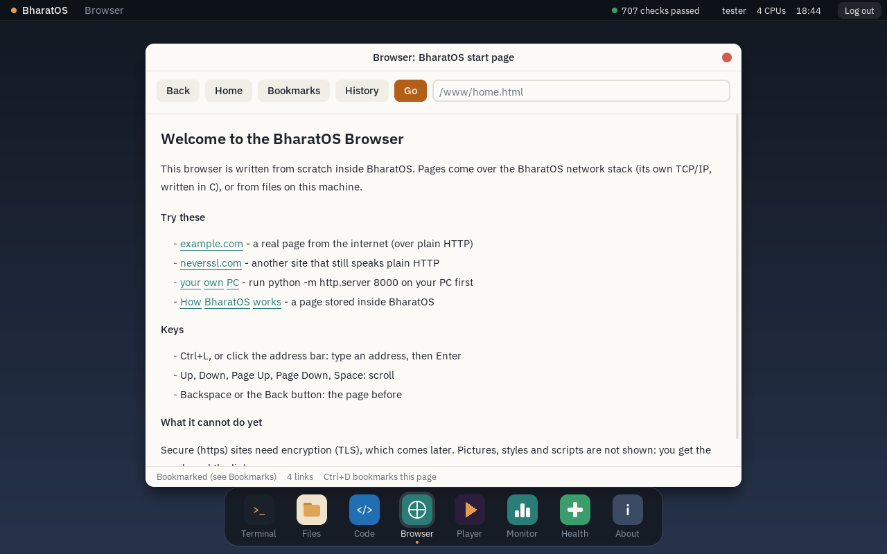
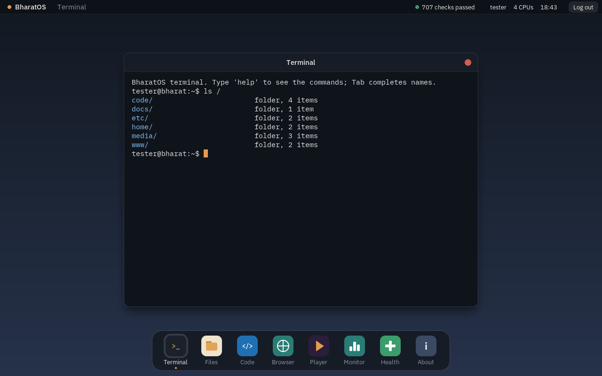
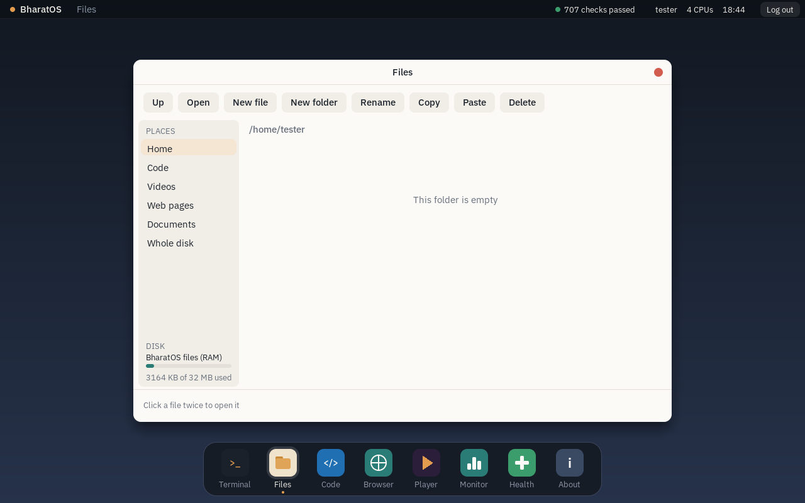
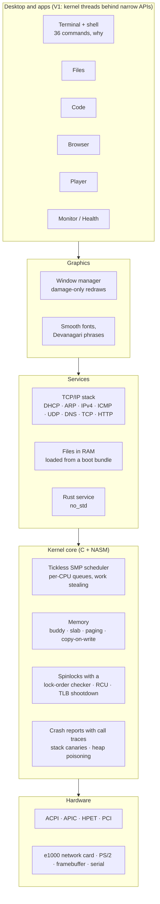
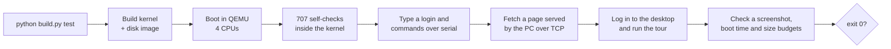
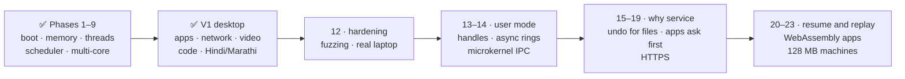

<div align="center">

# BharatOS

### An operating system written from scratch: kernel, desktop, network stack and apps, with no Linux underneath.

**It checks itself on every boot, explains itself in plain words, and is made for the people of Bharat.**


</div>

---

## In one minute

BharatOS is a complete, bootable operating system built from the first
instruction up: about **21,700 lines of kernel C and assembly**, plus a
Rust service. It boots on real PC firmware (BIOS and UEFI), uses every CPU
core, and runs a graphical desktop with its own **web browser, video
player, code editor, file manager and terminal**. It also has **its own
TCP/IP network stack**, written from scratch.

Three things set it apart:

| | |
|---|---|
| 🩺 **It proves itself on every boot** | **707 self-checks** run inside the kernel each time it starts: memory, scheduler, locks, files, network, every app. Every `python build.py test` then logs in, types commands, **fetches a real web page over its own TCP**, drives the desktop and checks a screenshot. A failure is reported, never hidden. |
| 💬 **It explains itself** | `why slow` and `why crash` answer in plain sentences from live system data, offline, with no AI guesswork. A crashed program is contained and explained; the system keeps running. |
| 🇮🇳 **It is made for Bharat** | The login screen greets you in **Hindi and Marathi** (नमस्ते · नमस्कार), and one key switches it to English, हिन्दी or मराठी. Next: running in 128 MB and working offline. |

## See it

<table>
<tr>
<td width="50%"><br><sub><b>Login in Hindi.</b> F1 switches English · हिन्दी · मराठी; phrases are shaped at build time, so the kernel needs no shaping engine.</sub></td>
<td width="50%"><br><sub><b>Browser.</b> Pages fetched over BharatOS's own TCP/IP, with links, Back, bookmarks and history.</sub></td>
</tr>
<tr>
<td><br><sub><b>Player.</b> Video full screen, a playlist of every clip in the folder, no codec needed. (Big Buck Bunny © Blender Foundation, CC BY.)</sub></td>
<td><br><sub><b>Terminal.</b> 36 commands, Tab completion, colours, 200 lines of scrollback, <code>ping</code>, <code>fetch</code>, <code>why</code>.</sub></td>
</tr>
<tr>
<td><br><sub><b>Files.</b> Places, a disk bar, copy, paste, rename; every file opens in the app that suits it.</sub></td>
<td><br><sub><b>Code.</b> Tabs, find (Ctrl+F), colours for C, Python, shell and Markdown, and Run for scripts.</sub></td>
</tr>
</table>

## What is inside



| Layer | Highlights |
|---|---|
| **Boot** | Limine on BIOS and UEFI; a splash whose progress bar follows the real boot steps and ends with the measured boot time |
| **CPU and memory** | all 32 CPU exceptions with full reports; buddy page allocator, slab caches, own page tables (read-only code, no-execute data), demand paging, copy-on-write |
| **Multi-core** | every CPU started; per-CPU run queues with work stealing; tickless timer (idle CPUs get no interrupts); spinlocks checked for lock-order mistakes; RCU; TLB shootdown |
| **Safety** | crashes of apps are contained and reported with named call traces; guard pages, stack canaries, heap poisoning and red zones |
| **Network** | Intel e1000 driver; DHCP, ARP, IPv4, ICMP, UDP, DNS, TCP with resends, HTTP/1.0 |
| **Desktop** | windows, dock, top bar with a live health badge, smooth anti-aliased fonts, screenshots (Print Screen), full-screen apps |
| **Rust** | a `no_std` Rust service built by an optional step and run on its own thread; the build still works without `rustc` |

## How it proves itself



- **707 boot self-checks** in 12 suites (memory, processes, scheduler,
  debugging, hardware, scaling memory, multi-core, input, files, shell,
  desktop, network and apps). They pass with 1 and 4 CPUs.
- **About 4 million host unit-test cases** run against the real heap,
  scheduler, buddy and slab code (`python build.py unit`).
- **13 crash-on-purpose kernels** check that every crash report is right
  (`python build.py test-faults`).
- **Budgets:** kernel size and boot time are checked on every run, and
  zero compiler warnings are allowed. CI boots every pull request.

## Quick start

**Needs:** Python 3.9+, Clang/LLD, NASM, QEMU (OVMF for UEFI). Rust is optional.

```bash
git clone https://github.com/Siddhesh-source/BharatOS.git
cd BharatOS
python scripts/fetch_limine.py     # once: the bootloader
python build.py demo               # the desktop in a QEMU window
```

Type your name (or press **F1** first for Hindi or Marathi), then Enter.
Try **Player**, **Browser → example.com**, **Code → Run** on `demo.sh`, or
in the Terminal: `why slow`, `ping 10.0.2.2`, `fetch http://example.com/`,
`ls /`. Press **F12** for a hands-free tour. To quit QEMU, press
**Ctrl+A** then **X**.

| Command | What it does |
|---|---|
| `python build.py demo [--auto]` | the desktop in a window (`--auto`: tour by itself) |
| `python build.py run [--window]` | boot with the text console in this terminal |
| `python build.py run-uefi` | boot through UEFI firmware |
| `python build.py test [--smp N]` | build, boot and verify everything (exit 0 = pass) |
| `python build.py test-faults` | 13 crash-on-purpose kernels, each report checked |
| `python build.py unit` | host unit tests (millions of cases, seconds) |
| `python build.py bench` | benchmarks into [docs/benchmarks.md](docs/benchmarks.md) |
| `python build.py debug` | QEMU paused for GDB/LLDB |

<details><summary><b>Windows / Linux setup</b></summary>

**Windows:** if the tools are not on `PATH`, copy `.env.example` to
`.env` and set `BHARAT_CLANG`, `BHARAT_LLD`, `BHARAT_OBJCOPY`,
`BHARAT_NASM`, `BHARAT_QEMU` (and `BHARAT_OVMF_*` for UEFI). Run
`chcp 65001` for box-drawing characters.

**Linux / WSL:** `sudo apt install python3 clang lld llvm nasm qemu-system-x86 ovmf`

**Rust (optional):** `rustup target add x86_64-unknown-none`. Without it,
the build says so and goes on; `BHARAT_NO_RUST=1` skips Rust on purpose.
</details>

## Where it is going



| Promise | Today | Next |
|---|---|---|
| Checks itself | ✅ 707 checks on every boot, health badge on the desktop | fuzzing, real hardware |
| Explains itself | ✅ `why slow`, `why crash` | a `why` service for every part |
| Crash-proof apps | ✅ contained crashes in kernel threads | user mode: an app crash can never touch the kernel |
| Undo for files | files in RAM | BharatFS: copy-on-write, safe from power cuts |
| Apps ask first | narrow APIs | handles (capabilities) and permission prompts |
| Made for Bharat | ✅ Hindi and Marathi login | 128 MB, offline-first, more languages |

The full plan and its reasons: [docs/UPDATES.md](docs/UPDATES.md) ·
the fastest path to finished: [FINAL.md](FINAL.md) ·
what's next: [WAY_AHEAD.md](WAY_AHEAD.md) · quick wins: [QUICK_WINS.md](QUICK_WINS.md)

## Documentation

| Read | For |
|---|---|
| [CONCEPTS.md](CONCEPTS.md) | the ideas in plain words |
| [docs/PROJECT_OVERVIEW.md](docs/PROJECT_OVERVIEW.md) | why the project exists, the selling points |
| [docs/design/HLD.md](docs/design/HLD.md) · [LLD.md](docs/design/LLD.md) · [UI.md](docs/design/UI.md) | how it fits together, exact structures, the look |
| [docs/phases/](docs/phases/) | how each finished phase works and is tested |
| [docs/BUG_JOURNAL.md](docs/BUG_JOURNAL.md) | hard bugs: symptom, cause, fix, guarding test |
| [CLAUDE.md](CLAUDE.md) | the contributor guide |

## Project structure

```text
build.py          the only build entry point (build, run, test, unit, bench)
boot/             Limine config; bundle/ = files loaded into RAM at boot
kernel/           arch/ acpi/ pci/ mm/ proc/ sched/ smp/ core/ drivers/
                  input/ fs/ net/ ui/ apps/ trace/ tests/
user/services/    hello-rs: the first Rust service (no_std)
scripts/          disk image, test harness, fonts, video, budgets
tests/unit/       host unit tests (no C library)
docs/             plan, designs, phase notes, logs, screenshots
```

**Tech:** C11 (freestanding), NASM, Rust (`no_std`, optional), Clang/LLD,
Limine, QEMU, Python build and tests. No external libraries in the kernel.
