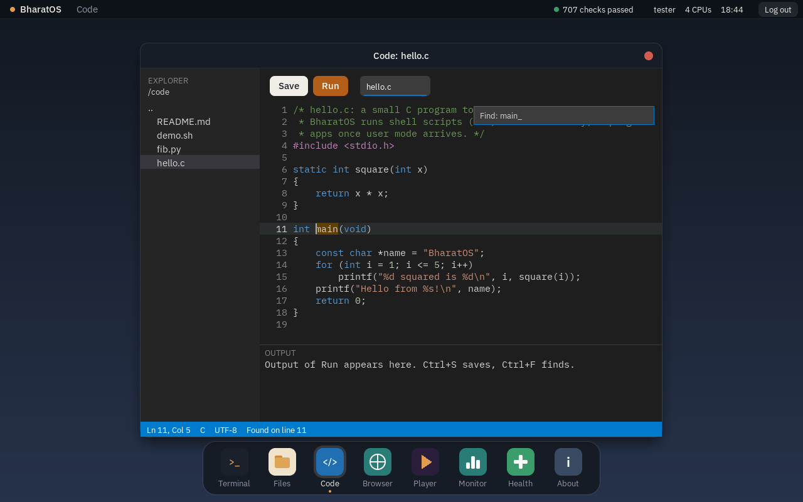
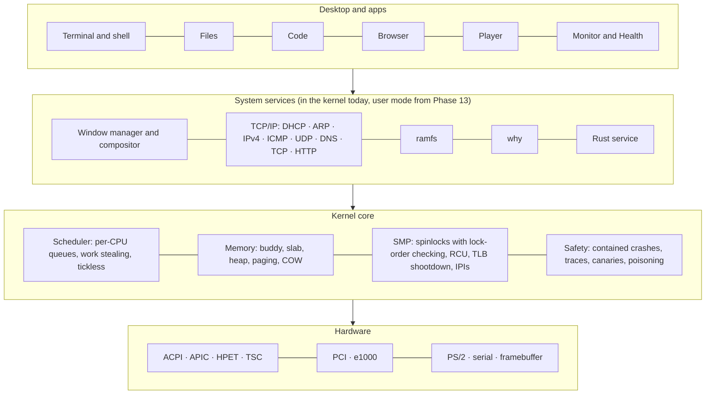
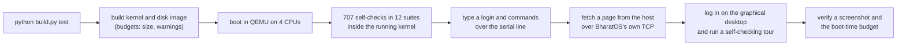
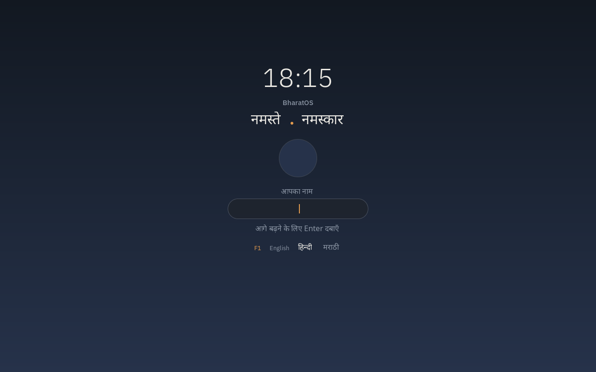
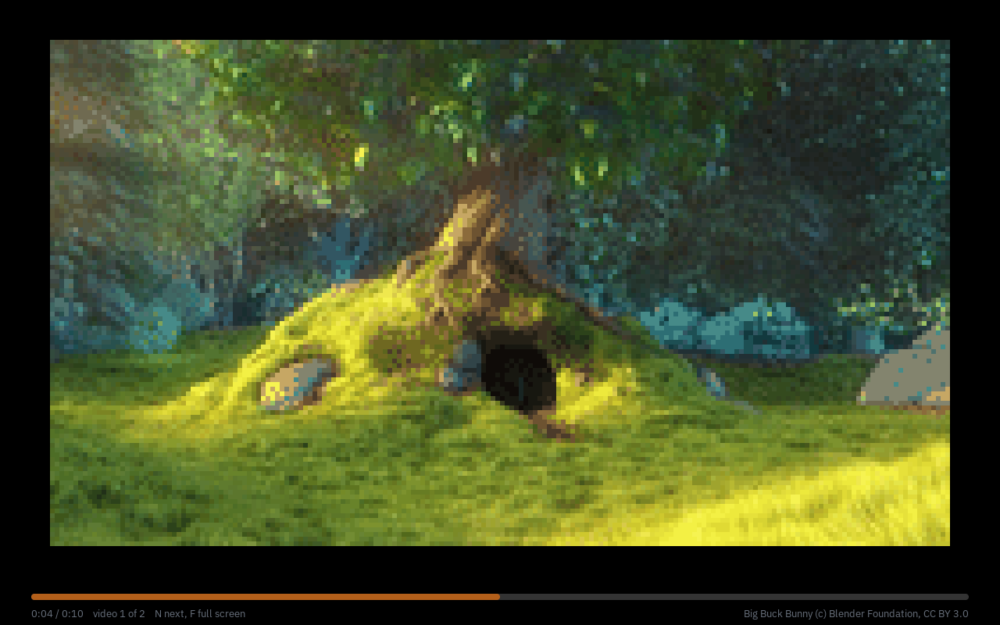
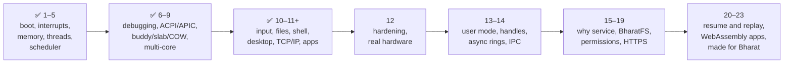

<div align="center">

# BharatOS

### A complete x86-64 operating system built from the first instruction up: kernel, multi-core scheduler, memory manager, drivers, TCP/IP stack, window system and apps.

**No Linux. No borrowed kernel. No libc. About 22,000 lines of kernel C and assembly, proven by 707 checks inside the kernel on every boot.**




</div>

---

## At a glance

| | |
|---|---|
| **Kernel** | ~21,700 lines of freestanding C11 and NASM, plus ~6,300 lines of in-kernel tests |
| **Runs on** | x86-64 PCs, BIOS and UEFI (Limine), 1 to 16 CPUs |
| **Built** | 11 phases plus two rounds of extras: boot → interrupts → memory → threads → scheduler → debugging → modern hardware → scalable memory → multi-core → input/files/shell → desktop → network and apps |
| **Proof** | **707 self-checks inside the real kernel on every boot**, ~4 million host unit-test cases on the real allocator and scheduler code, 13 crash-on-purpose kernels, an end-to-end test that types at the login prompt and fetches a web page over its own TCP |
| **Discipline** | 44 recorded design decisions with the rejected options, 23 hard bugs written up (symptom → root cause → fix → guarding test), size and boot-time budgets checked by every test run, zero compiler warnings |

## What was built

Every layer below was written for BharatOS and is exercised by boot tests.

| Layer | What it does |
|---|---|
| **Boot and CPU** | Limine hand-off into a higher-half 64-bit kernel; own GDT/TSS and IDT; handlers for all 32 CPU exceptions with full register reports; separate emergency stacks (IST) so even a kernel stack overflow is reported |
| **Hardware discovery** | ACPI (RSDP, MADT, HPET, MCFG), PCI enumeration (ECAM or port I/O), local and I/O APIC, HPET; the 1980s PIC and PIT used only to calibrate, then masked |
| **Time** | TSC and APIC timer calibrated against the HPET (PIT as fallback); **tickless** one-shot APIC timers per CPU, re-armed lazily only when a deadline moves earlier; an idle CPU takes no interrupts |
| **Physical memory** | **buddy allocator** (orders 0–10, split/merge, per-page reference counts) with a hot-page cache; **slab caches** for kernel objects; a kernel heap with **poisoning and red zones always on** |
| **Virtual memory** | own 4-level page tables with W^X (read-only code, no-execute data); one address space per process; **demand paging**, **copy-on-write** and shareable memory objects; guard pages under every kernel stack |
| **Threads** | processes and kernel threads (64 / 256), assembly context switch saving every callee register, corrupted-context detection before every switch |
| **Scheduler** | preemptive, **per-CPU run queues**, **work stealing** by idle CPUs, least-loaded placement, IPI wake-ups; wait queues keyed by thread ID so a killed sleeper can never be woken by mistake |
| **Multi-core** | every CPU started through the bootloader's multiprocessor hand-off; per-CPU data; named spinlocks with a **lock-order checker** (lockdep-style: it records class orders and reports an inversion with both call traces before any deadlock happens); **TLB shootdown**; **RCU** with grace periods from one IPI round |
| **Debuggability** | panics print **symbolised call traces** (a symbol table built by a second link, verified not to move code) and the last kernel events from a trace ring; compiler stack protector; GDB/LLDB attach; faults in opted-in threads are **contained**: full report, that thread ends, the system keeps running |
| **Input** | PS/2 keyboard and mouse and serial terminals decoded into one event stream; two queues so the text console and the desktop work at the same time |
| **Files** | an in-memory file system (ramfs: sorted trees, open-file table, rename, size limits) seeded at boot from a tar bundle |
| **Networking** | an **Intel e1000 driver** (DMA descriptor rings) and a **TCP/IP stack written from scratch**: DHCP, ARP, IPv4, ICMP, UDP, DNS, **TCP** (handshake, retransmission with back-off, in-order delivery, flow control), HTTP/1.0 with redirects |
| **Graphics** | double-buffered compositing that redraws only the damaged rectangle; anti-aliased rounded shapes, soft shadows and smooth fonts, all in integer maths (the kernel has no floating point); **Devanagari** shaped at build time, so no shaping engine runs in the kernel |
| **Desktop and apps** | a window manager with a login screen in English, Hindi and Marathi, and nine apps: Terminal (a 36-command shell), Files, Code (an editor with syntax colouring that runs scripts), Browser (an HTML layout engine over its own HTTP), Player (video without a codec), Monitor (live per-CPU load), Health (self-checks, lock-order and crash demos), Text editor, About |
| **Explains itself** | `why slow` and `why crash` turn live kernel data (per-thread CPU time, memory, the last contained crash) into plain sentences |
| **Rust** | the first service in Rust (`no_std`), behind a copy-in/copy-out mailbox, the shape the planned user-mode rings will have; the build skips it cleanly without `rustc` |

## Architecture



**Where it is heading** (decision D1): a microkernel. Drivers, file
system and network move to restartable user-mode services; programs talk
to the kernel through **async system-call rings** and hold **handles
(capabilities)** instead of global names. V1 runs the apps as kernel
threads behind narrow APIs so that move stays mechanical (D28).

## Engineering highlights worth a deep dive

| Topic | What makes it interesting |
|---|---|
| **Tickless SMP scheduling** | one-shot timers per CPU re-armed only when a deadline moves earlier (a naive design doubled switch cost; bug 10); the run-queue lock is handed across the context switch so no CPU can steal a thread whose registers are still being saved (D23) |
| **Lock-order checking** | every spinlock has a class; the checker learns the order classes are taken in and reports an inversion, with the earlier and current call traces, the first time it happens rather than when it deadlocks |
| **RCU and TLB shootdown** | readers run with interrupts off; a grace period is one IPI answered by every other CPU (D25); shootdowns can be sent while holding locks because waiters keep answering requests (D24) |
| **Memory that scales** | buddy plus slab plus a hot-page cache; demand paging and copy-on-write with per-page reference counts; heap poisoning catches use-after-free at the moment of reuse |
| **Crash containment** | a fault in an opted-in kernel thread is reported in full, then that thread is sent to `thread_exit` by rewriting where the interrupt returns; refused when it holds a lock or the fault is a double fault (D30) |
| **Symbolised traces without DWARF** | the kernel links twice: once to learn addresses, once with a generated symbol table, and the build checks no function moved (D18) |
| **TCP/IP from scratch** | checksums, ARP cache, DHCP, DNS, TCP state machine with retransmission and flow control; the boot test fetches a real page from the host over it |
| **A compositor in integer maths** | damage-rectangle redraws, alpha blending and anti-aliased curves without floating point (the kernel is built with `-mno-sse`) |
| **Indic text without a shaping engine** | Devanagari phrases are shaped once at build time (HarfBuzz via Pillow/raqm) and blended as coverage maps at run time (D16) |

## How it proves itself



| Suite | Checks | Examples |
|---|---|---|
| Memory | 114 | allocator exhaustion, page permissions, invalid-access faults, heap integrity |
| Processes | 83 | exact switch traces, all registers preserved, a 60,000-switch stress, stack isolation |
| Scheduler | 26 | preemption of threads that never yield, fairness, idle |
| Debug and hardening | 29 | symbol lookup, trace walk, random canaries, use-after-free and overflow caught |
| Hardware | 38 | ACPI tables, PCI, sleep accuracy, tickless idle, I/O APIC routing |
| Memory that scales | 62 | buddy split/merge, slab limits and poisoning, demand paging, copy-on-write |
| Multi-core | 29 | lost-update stress on every CPU, lock-order inversion caught, TLB shootdown, RCU, work stealing |
| Input | 32 | keyboard, mouse and terminal decoding through the real IRQ paths |
| Files | 46 | every operation, bad paths, every size limit, the boot bundle |
| Login and shell | 58 | login rules, scripted commands with checked output, contained crashes |
| Desktop | 53 | clipping, damage-only redraws, window focus/drag/close, every app driven by keys and clicks |
| Network and apps | 138 | DHCP parsing, ARP, ping, TCP refusals, HTML layout, the Rust service, every app feature |

Outside the kernel: `python build.py unit` runs about **4 million**
randomised cases of the real heap, scheduler, buddy and slab code against
reference models, as normal programs on the host with no C library (D17).
`python build.py test-faults` builds **13 kernels that crash on purpose**
(null pointer, stack overflow, double fault, corrupted context, stack
smash, use-after-free, heap overflow, lock-order inversion, ...) and
checks each report. CI boots every pull request.

## See it

<table>
<tr>
<td width="50%"><br><sub><b>Login in Hindi or Marathi.</b> Devanagari shaped at build time; F1 switches language.</sub></td>
<td width="50%"><br><sub><b>Browser.</b> HTML layout over BharatOS's own HTTP and TCP.</sub></td>
</tr>
<tr>
<td><br><sub><b>Terminal.</b> A 36-command shell: files, threads, CPUs, network, self-checks, crash and lock-order demos.</sub></td>
<td><br><sub><b>Player.</b> Video with no codec: a palette and raw frames, timed by the clock. (Big Buck Bunny © Blender Foundation, CC BY.)</sub></td>
</tr>
</table>

## Why BharatOS

Operating systems fail people in everyday ways: a power cut breaks a
file, an old laptop crawls, an app reads your photos, and nothing says
*why*. BharatOS is built around five answers:

| Promise | Today | Next |
|---|---|---|
| **Checks itself** | ✅ 707 checks on every boot; a live health badge on the desktop | fuzzing; real-hardware runs |
| **Explains itself** | ✅ `why slow`, `why crash` from live data | a `why` service with an event diary (Phase 15) |
| **Undo for your files** | in-memory files | BharatFS: copy-on-write, safe from power cuts, every version kept (Phase 17) |
| **Apps ask first** | contained crashes | user mode, handles and permission prompts (Phases 13, 18) |
| **Made for Bharat** | ✅ Hindi and Marathi login | 128 MB machines, offline-first, more scripts (Phase 22) |

## Roadmap



The plan and its reasons: [docs/UPDATES.md](docs/UPDATES.md) · the
fastest path to finished: [FINAL.md](FINAL.md) · next steps:
[WAY_AHEAD.md](WAY_AHEAD.md)

## Quick start

**Needs:** Python 3.9+, Clang/LLD, NASM, QEMU (OVMF for UEFI). Rust optional.

```bash
git clone https://github.com/Siddhesh-source/BharatOS.git
cd BharatOS
python scripts/fetch_limine.py     # once: the bootloader
python build.py demo               # the desktop in a QEMU window (F12: guided tour)
python build.py test               # build, boot and verify everything (exit 0 = pass)
```

| Command | What it does |
|---|---|
| `python build.py demo [--auto]` | the desktop in a window; `--auto` runs the tour hands-free |
| `python build.py run [--window]` / `run-uefi` | boot with the text console here, BIOS or UEFI |
| `python build.py test [--smp N]` | the full verification pipeline on N CPUs |
| `python build.py test-faults` | 13 crash-on-purpose kernels, each report checked |
| `python build.py unit` | ~4 million host unit-test cases |
| `python build.py bench` | context-switch, allocator and trace costs into [docs/benchmarks.md](docs/benchmarks.md) |
| `python build.py debug` | QEMU paused for GDB or LLDB |

<details><summary><b>Windows / Linux setup</b></summary>

**Windows:** if the tools are not on `PATH`, copy `.env.example` to
`.env` and set `BHARAT_CLANG`, `BHARAT_LLD`, `BHARAT_OBJCOPY`,
`BHARAT_NASM`, `BHARAT_QEMU` (and `BHARAT_OVMF_*` for UEFI).

**Linux / WSL:** `sudo apt install python3 clang lld llvm nasm qemu-system-x86 ovmf`

**Rust (optional):** `rustup target add x86_64-unknown-none`; without it
the build says so and continues.
</details>

## Documentation

| Read | For |
|---|---|
| [docs/PROJECT_OVERVIEW.md](docs/PROJECT_OVERVIEW.md) | the whole project on one page: what, why, how it is proven |
| [CONCEPTS.md](CONCEPTS.md) | the ideas in plain words |
| [docs/design/HLD.md](docs/design/HLD.md) · [LLD.md](docs/design/LLD.md) | how the pieces fit; exact structures and interfaces |
| [docs/phases/](docs/phases/) | each phase: what was built, how it is tested, known limits |
| [docs/UPDATES.md §10](docs/UPDATES.md) | the decision log (44 decisions with rejected options) |
| [docs/BUG_JOURNAL.md](docs/BUG_JOURNAL.md) | 23 hard bugs: symptom, root cause, fix, guarding test |
| [CLAUDE.md](CLAUDE.md) | the contributor guide |

```text
build.py          one entry point: build, run, test, unit, bench, debug
kernel/           arch/ acpi/ pci/ mm/ proc/ sched/ smp/ core/ trace/
                  drivers/ input/ fs/ net/ ui/ apps/ tests/
user/services/    the first Rust service (no_std)
scripts/          disk image, test harness, budgets, fonts, video, symbols
tests/unit/       host unit tests (no C library)
docs/             plan, designs, phases, decisions, bugs, benchmarks
```
