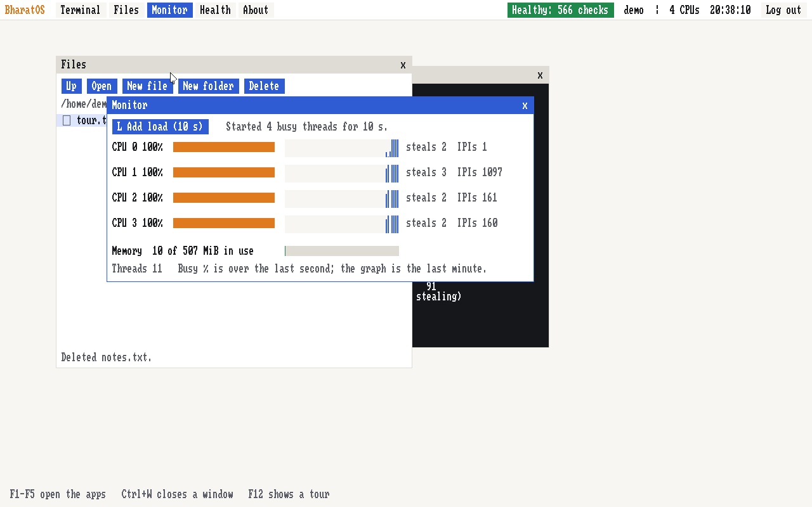
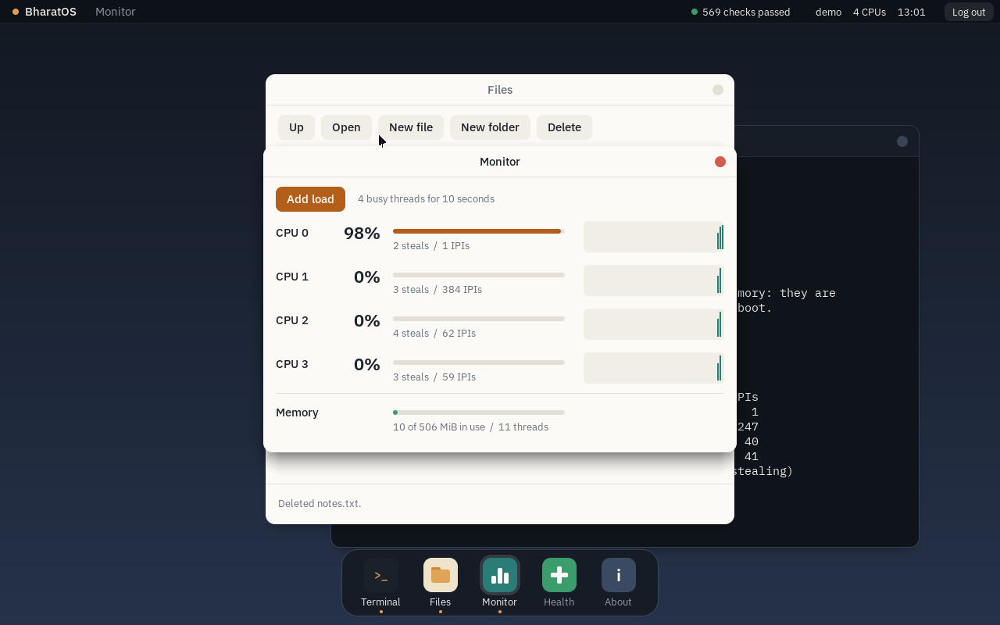
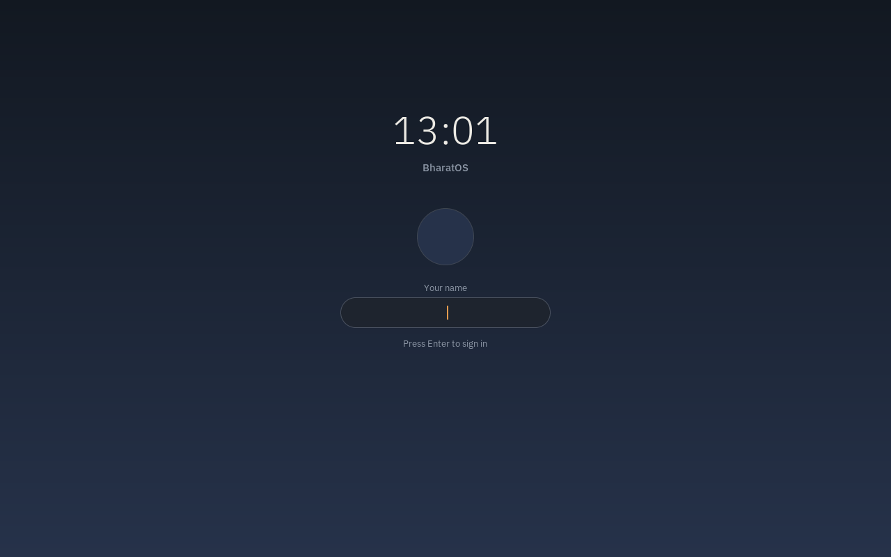
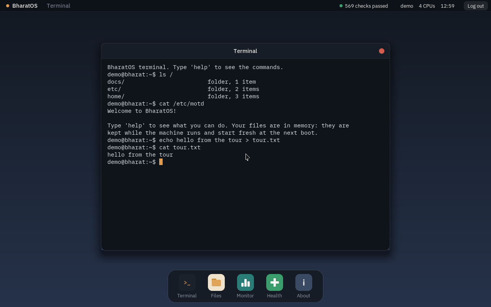
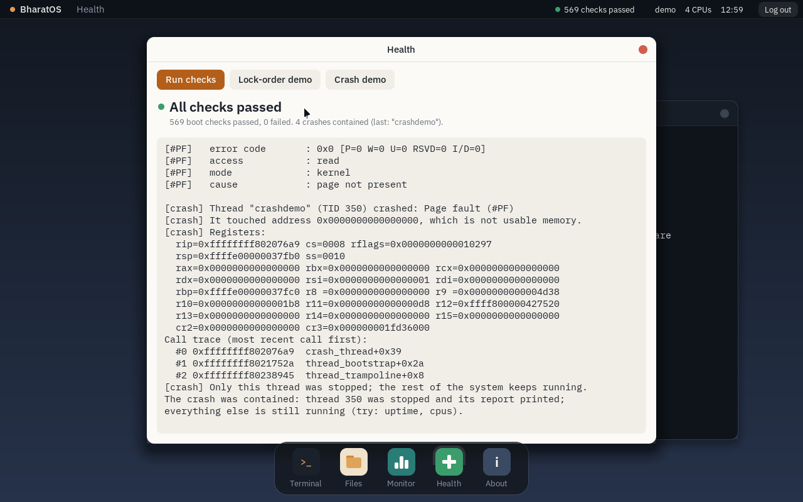

# BharatOS desktop: design review and improvements

A blunt review of the V1 desktop as merged in Phase 11 (PR #8), the plan
to fix it, and what changed. Screens were captured with QEMU `screendump`
at 1280 x 800 (the boot test's resolution).

## Verdict on the Phase 11 desktop

**Design score: D. AI-slop score: B** (it isn't generic template output;
it's dated).

**First impression.** It looks like DOS from 1991 that someone gave
windows. The first three things my eye lands on: the chunky orange
"BharatOS" made of scaled-up BIOS pixels, a row of identical saturated
blue buttons, and a pile of overlapping grey title bars. If I had to
describe it in one word: **beige**.

What it does well: the structure is right (top bar, focused window,
apps that work), redraws only touch what changed, and the colours follow
a written palette. Only the look is wrong.

| Category | Grade | Why |
|---|---|---|
| Visual hierarchy | D | Every element has the same weight. Title bars, buttons and badges all shout. Nothing is clearly the main thing on screen. |
| Typography | **F** | One font: the 1981 IBM BIOS 8x8 bitmap, stretched to 8x16, one size, one weight, no smoothing. The logo is the same font stretched 4x. This alone makes it 90s. |
| Spacing and layout | D | 8 px padding everywhere, text nearly touching edges, new windows cascade 40 px apart and bury each other, the About and Health windows are half empty. |
| Colour and contrast | C | The UI.md palette is fine on paper, but it's spread flat: a dead beige wallpaper, full-strength blue on every button, a loud green badge, orange bars. White text on the blue buttons passes contrast; it's just loud. |
| Interaction states | D | Focus is shown only by a blue title bar. Buttons have no pressed state. Selection is a flat pale band. The pointer is a white arrow with a black outline that disappears on light windows. |
| Resolution handling | C | Fixed sizes. It works at 1280 x 800, isn't tuned for anything else, and nothing breaks either. |
| Content and microcopy | C | Instructions where design should be: "F1-F5 open the apps  Ctrl+W closes a window  F12 shows a tour" stays on the desktop for good, and the login screen has two lines of instructions. Buttons are named "1 Run checks" and "L Add load (10 s)" (keyboard letters glued onto labels). "Welcome!" is filler. |
| Motion | n/a | None, which UI.md asks for. |
| Performance feel | B | Damage-only redraws: moving the pointer touches two small boxes, not the screen. |
| AI slop | B | No gradients-for-the-sake-of-it, no fake stats. But the hint line and labels made of keyboard shortcuts read as unfinished. |

## Findings

| # | Impact | Finding | Fix |
|---|---|---|---|
| 1 | High | Bitmap 8x8 font everywhere, one size, no smoothing (`gfx.c` draws `font8x8` at 2x height) | Smoothed fonts rendered ahead of time from IBM Plex Sans (interface) and IBM Plex Mono (terminal), in 6 sizes and 2 weights; drawn with real blending |
| 2 | High | Flat beige wallpaper with no depth; windows sit on it like stickers | Deep slate gradient wallpaper; ivory windows with rounded corners and soft offset shadows; the focused window gets a deeper shadow |
| 3 | High | Saturated blue title bars and buttons compete for attention | Title bars become part of the window surface: centred title, a hairline below. One primary button per window in burnt saffron; the rest are quiet ivory-grey pills |
| 4 | High | Windows cascade into a pile (40 px steps from the same corner) | Windows open centred in the free area, offset only when another window is already there |
| 5 | High | The top bar is a strip of buttons; the app launcher and status share one line | Thin dark top bar for status only (focused app's name, health, CPUs, user, clock, Log out); a dock at the bottom centre with app icons and a dot under the running apps |
| 6 | Medium | Permanent instruction line on the desktop; instructions on the login screen | Removed. Keys still work; the tour and the docs explain them |
| 7 | Medium | Button labels carry keyboard letters ("1 Run checks", "L Add load (10 s)") | Plain labels ("Run checks", "Add load"); the keys still work |
| 8 | Medium | Login screen is a boxed form on beige with a footer of rules | Lock-screen layout on the wallpaper: large clock, round avatar showing your initial, a soft translucent name field with a saffron caret |
| 9 | Medium | Boot splash: orange pixel logo, then a bright blue full-width log panel | Calm dark splash: smooth wordmark, thin progress line, step name; the boot log below is dimmed into the same background |
| 10 | Medium | Files: 20 px rows, drawn box icons, flat selection band | 32 px rows, folder and page icons, rounded saffron-tint selection, empty-folder state, the name field drawn as a real input |
| 11 | Medium | Monitor: orange and blue bars at full strength, a cramped grey graph | Big percentages, thin rounded bars (teal, saffron above 80%), a soft graph of the last minute |
| 12 | Medium | Health and About are raw command output in a box | Health opens with a status line (green dot, "All 566 checks passed"); output sits on a soft panel. About is a proper page: wordmark, then label and value rows |
| 13 | Polish | Pointer: white arrow, lost on light windows | Dark arrow with a light outline, readable on both |
| 14 | Polish | Terminal cursor is an orange underscore | Saffron block caret; terminal body and title bar in matching dark |

## Litmus checks (before → after)

| Check | Before | After |
|---|---|---|
| Brand clear in the first screen? | yes, but crude | yes |
| One strong visual anchor? | no | yes (the focused window, lifted by its shadow) |
| Understandable by scanning titles alone? | partly | yes |
| Each area has one job? | no (top bar did three) | yes (top bar: status; dock: apps) |
| Would it feel premium with shadows removed? | no | mostly: type and spacing carry it |

The "after" column and the screenshots below were checked after the
redesign was built. See [What changed](#what-changed).

## The new look (design system)

Replaces the light theme in `docs/design/UI.md` (UI.md now documents it).

| Token | Value | Used for |
|---|---|---|
| `wall-top` → `wall-bottom` | `#121821` → `#26324A` | wallpaper gradient, splash |
| `surface` | `#FBFAF7` | windows (warm ivory) |
| `surface-2` | `#F1EEE8` | quiet buttons, panels |
| `line` | `#E4E0D8` | hairlines, field borders |
| `text` / `muted` | `#1D232B` / `#68707C` | text on ivory (muted is 4.6:1) |
| `on-dark` / `on-dark-muted` | `#ECEAE4` / `#8C96A5` | text on the wallpaper and top bar |
| `primary` | `#B35F1A` | one primary button per window (ivory text 4.7:1) |
| `saffron` | `#E39B4E` | brand, caret, progress, running dots (on dark only) |
| `accent-soft` | `#F5E6D3` | selected rows |
| `teal` | `#2A7C76` | data (CPU bars, graphs) |
| `ok` / `warn` / `danger` | `#3A9D6B` / `#C98A2E` / `#D25C4D` | status |
| `term-bg` / `term-text` | `#0F141B` / `#E6E8EB` | terminal |

Type: IBM Plex Sans (interface: 13, 15, 15 medium, 22 semibold, 56 light)
and IBM Plex Mono 15 (terminal, editor, command output). Both are under
the SIL Open Font License; the licence ships beside the font data.
Spacing on an 8 px grid with 16 px insets; radii 12 (windows), 8
(buttons, rows), 18 (dock), full (avatar, dots).

## What changed

| Before | After |
|---|---|
|  |  |
| |  |
| |  |
| |  |

All 14 findings are fixed:

| # | Fix | Where |
|---|---|---|
| 1 | Smooth IBM Plex fonts, 6 faces, drawn with real blending; the 8x8 font is now only a fallback | `scripts/make_fonts.py`, `kernel/ui/fonts.bin`, `font.c`, `gfx.c` |
| 2 | Slate gradient wallpaper (drawn once, copied per redraw), rounded ivory windows, soft shadows | `wm.c`, `gfx.c` (`gfx_round`, `gfx_shadow`, `gfx_gradient`) |
| 3 | Title is part of the window, hairline below, round close button; one primary button per window | `wm.c` (`draw_window`, `ui_buttons`) |
| 4 | Windows open centred, offset only when the spot is taken | `wm.c` (`place`) |
| 5 | Top bar for status only; dock with icons, names and running dots | `wm.c`, `apps/icons.c` |
| 6 | Hint line and login instructions removed | `wm.c`, `desktop.c` |
| 7 | Plain button labels; keys still work | apps |
| 8 | Lock-screen login: time, avatar initial, labelled soft field | `desktop.c` |
| 9 | Dark splash with a thin progress line; the boot log dimmed into the background | `splash.c`, `fbcon.c` |
| 10 | Files: 32 px rows, folder and page icons, rounded selection, empty state, a real input for names | `files_app.c` |
| 11 | Monitor: big percentages, thin teal bars (burnt saffron above 80%), soft one-minute graph | `monitor_app.c` |
| 12 | Health status line and output panel; About as a page with label and value rows | `info_app.c` |
| 13 | Dark pointer with a light outline, hidden until the mouse first moves | `wm.c` |
| 14 | Saffron block caret; dark terminal title and body | `terminal_app.c`, `wm.c` |

Found and fixed while checking the "after" screenshots:
- A hard dark band under every window: the shadow's solid core showed
  below the window. The shadow shape is now smaller than the window, so
  only its fade shows.
- The dock's focus highlight was half drawn: changing focus did not mark
  the dock for redraw. The dock now redraws with the top bar.

**After: Design score B, AI-slop score A-.**

| Category | Before | After | Why it isn't higher |
|---|---|---|---|
| Visual hierarchy | D | B+ | Several windows open at once still crowd the centre |
| Typography | F | A- | No ellipsis on long names; ASCII only |
| Spacing and layout | D | B | Windows can't be resized to fit content |
| Colour and contrast | C | A- | |
| Interaction states | D | C+ | Still no hover or pressed states, and no keyboard focus ring on buttons |
| Content and microcopy | C | B+ | About repeats the headline under the wordmark |
| AI slop | B | A- | Dock icon tiles are a convention, not decoration |

Tests: 53 desktop self-checks (smooth text, rounded corners, shadows
added), the quick tour, and the screenshot check (wallpaper colour, top
bar darker than the wallpaper, at least 32 colours) pass on 1, 2 and 4
CPUs. The 13 crash demos pass. The kernel is 16,637 lines (limit 17,000).

## Still to do (for Phase 12 or Phase 21)

- Hover and pressed states for buttons and dock tiles (needs the pointer
  position passed to apps), and a visible keyboard focus ring.
- Cut long file names with "…" instead of letting them run under the
  size column.
- Resizable windows; remember window positions.
- The boot log under the splash still uses the 8x8 font (it is the
  screen console's own font, kept for crash reports).
- A light wallpaper option, and larger text for low-vision users.
- Screenshot comparison against these screens (Phase 12).
